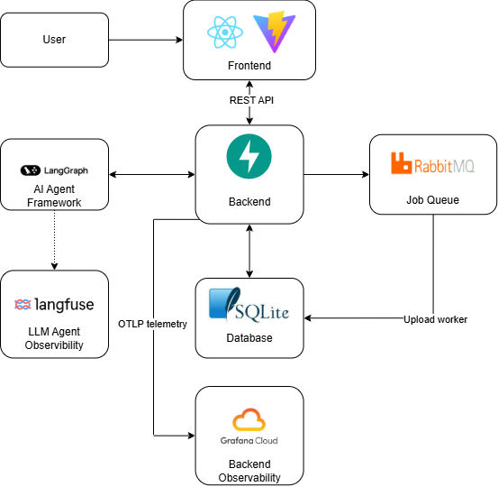
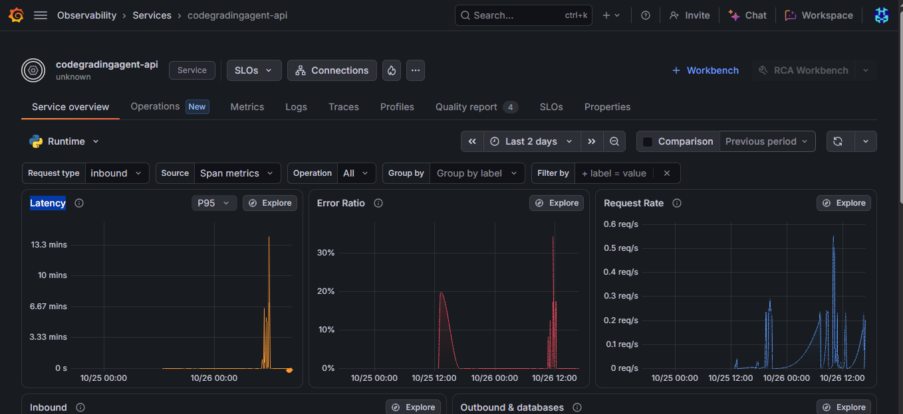

# CodeGradingAgent

**An AI-powered code grading assistant for instructors.**

CodeGradingAgent helps instructors manage code-grading workflows through a conversational interface. Instead of manually navigating every grading operation, instructors can ask the agent to retrieve assignment information, create rubrics, select submissions, and evaluate code against grading criteria.

The project explores how an AI agent can be integrated into a practical application with structured workflows, asynchronous processing, persistent grading records, and human oversight.

> **Project status:** Functional prototype for demonstrating AI agent workflows and software architecture. The current evaluation focuses on workflow correctness and system behavior rather than establishing the absolute accuracy of AI-generated grades.

## Table of Contents

- [Overview](#overview)
- [Key Features](#key-features)
- [Application Architecture](#application-architecture)
- [LangGraph Agent Architecture](#langgraph-agent-architecture)
- [Observability](#observability)
- [Getting Started](#getting-started)
  - [Run Locally](#run-locally)
  - [Run with Docker Compose](#run-with-docker-compose)
  - [Deployment](#deployment)
- [Evaluation](#evaluation)
- [Project Structure](#project-structure)
- [Limitations](#limitations)

## Overview

CodeGradingAgent is designed around a simple idea: **instructors should be able to interact with grading workflows naturally, while the application retains control over execution and data changes.**

The instructor communicates with an AI agent through a React chat interface. The agent interprets the request and routes it to the appropriate action, such as answering a question, preparing a rubric, managing selected submissions, or generating grading results.

The backend executes these actions through application services and database operations. Tasks that can take longer, such as submission uploads, can be handled asynchronously by a background worker.

AI-generated results are treated as proposals rather than automatically trusted decisions. The application is designed to keep AI reasoning and application-side operations within a controlled workflow.

### Typical workflow

1. **Set up an assignment** — provide assignment information and grading criteria.
2. **Select submissions** — choose the code submissions to work with.
3. **Interact with the agent** — ask questions, create a rubric, or request grading.
4. **Review the results** — inspect the proposed scores and feedback.
5. **Continue the workflow** — discuss results or request further review as needed.

## Key Features

- **Conversational grading interface:** interact with grading operations through an instructor-facing chat UI.
- **Context-aware actions:** route requests to relevant application operations instead of treating every message as a generic question.
- **Rubric generation:** generate structured grading criteria from instructor requests.
- **Submission management:** select and manage submissions associated with a grading session.
- **AI-assisted grading:** generate proposed scores and feedback based on available assignment context and rubrics.
- **Asynchronous processing:** use RabbitMQ and a background worker to handle submission-upload jobs without requiring every operation to finish within the original HTTP request.
- **Observability:** support Langfuse tracing and optional OpenTelemetry export for inspecting application and AI execution.

## Application Architecture

The application separates the instructor interface, API, AI workflow, background processing, and persistent data.



### Main components

| Component | Responsibility |
|---|---|
| React frontend | Provides the instructor-facing chat interface and displays results. |
| FastAPI backend | Exposes API endpoints, validates requests, coordinates application services, and manages data access. |
| LangGraph agent | Interprets instructor requests and orchestrates the appropriate workflow. |
| Gemini API | Provides the language-model capabilities used by the agent. |
| SQLite | Stores application data in the current demo configuration. |
| RabbitMQ | Distributes asynchronous jobs to background consumers. |
| Upload worker | Processes queued submission-upload jobs and persists their results. |
| Langfuse | Supports inspection of LLM and agent traces. |
| OpenTelemetry | Exports application telemetry to Grafana Cloud via OTLP for centralized observability. |

The diagram represents the logical architecture. The API, agent, and worker are application components and do not necessarily run as separate deployed services in every configuration.

## LangGraph Agent Architecture

LangGraph represents the agent as a controlled workflow rather than a single unrestricted LLM call.

The agent interprets the instructor's message, routes it to the appropriate action, executes the corresponding workflow, and returns a structured result. Different actions follow explicit paths, including a sequential rubric-generation and grading workflow when both operations are requested.

### Design Principles

**1. Explicit Action Routing**

Different requests require different operations. Asking about assignment requirements should not trigger grading, and selecting a submission should not automatically generate a score.

**2. Structured State and Outputs**

The agent uses assignment context, conversation history, and submission data to produce structured action results that the backend can validate and process.

**3. Separation of AI Proposals and Application Data**

Generating a rubric or proposed grade is distinct from applying the corresponding changes. The application controls validation, approval, and persistence according to the session's approval settings.

**4. Controlled Execution**

Explicit nodes and conditional routing make the agent's behavior easier to inspect and test than an opaque sequence of LLM calls.

**5. Observability**

Langfuse tracing and OpenTelemetry telemetry exported to Grafana Cloud help monitor execution, investigate failures, and analyze latency.

## Observability

### LLM Tracing — Langfuse


### Application Telemetry — Grafana Cloud



## Getting Started

Choose the setup that best fits your needs.

| Option | Best for | Main consideration |
|---|---|---|
| Local development | Editing and debugging | Backend and frontend are started separately. |
| Docker Compose | Running the complete local environment | Requires Docker and Docker Compose. |
| Render deployment | Sharing a hosted demo | Uses external services and has persistence limitations. |

### Run Locally

#### Prerequisites

- Python and the dependencies specified by the backend.
- Node.js and npm.
- RabbitMQ.
- A Gemini API key for AI-powered features.
- Optional Langfuse credentials for AI observability.

#### 1. Configure the backend

Follow the setup instructions in [`backend/README.md`](./backend/README.md) for:

- Installing Python dependencies.
- Configuring environment variables.
- Initializing the SQLite database.
- Starting the FastAPI application.
- Running the RabbitMQ worker.

Configure the required Gemini credentials in the backend environment.

#### 2. Start the frontend

From the repository root:

```powershell
cd frontend
npm install
npm run dev
```

Open [http://localhost:5173](http://localhost:5173).

The development frontend communicates with the API at [http://localhost:8000](http://localhost:8000).

### Run with Docker Compose

From the repository root:

```bash
docker compose up --build
```

The following services are exposed locally:

| Service | URL |
|---|---|
| Frontend | [http://localhost:8080](http://localhost:8080) |
| FastAPI backend | [http://localhost:8000](http://localhost:8000) |
| RabbitMQ Management UI | [http://localhost:15672](http://localhost:15672) |

The development RabbitMQ credentials default to `codegrading` / `codegrading-dev-password`. Change these credentials before using the setup outside local development.

Optionally copy `backend/.env.example` to `backend/.env` and configure Gemini, Langfuse, authentication, and telemetry settings.

Docker Compose uses volumes for the configured application database and RabbitMQ data.

Stop the services:

```bash
docker compose down
```

Remove the associated persisted volumes as well:

```bash
docker compose down --volumes
```

**Warning:** The second command deletes the data stored in those volumes.

### Deployment

For deployment version (Render), visit [https://codegrading-frontend.onrender.com/](https://codegrading-frontend.onrender.com/)

## Evaluation

The project evaluates the system from two perspectives: **agent behavior and workflow correctness**, and **end-to-end performance under a batch workload**.

### 1. Agent Behavior Evaluation

The agent is evaluated using [DeepEval](https://docs.confident-ai.com/) with Gemini as the LLM judge. The evaluation uses a golden dataset at `backend/evaluation/golden_case.json`, containing four representative scenarios.

#### Test scenarios

| Test case | Context | Expected behavior |
|---|---|---|
| `answer-assignment-question` | An instructor asks about an assignment with no attached submissions. | Explain the assignment requirements without creating a rubric or grading code. |
| `create-rubric` | An assignment has no rubric, and the instructor requests a 10-point rubric. | Propose clear grading criteria totaling 10 points without grading code or claiming the rubric was saved. |
| `select-submission` | Multiple submissions are available, and the instructor requests a specific file. | Attach only the requested submission without grading it in the same step. |
| `grade-attached-submission` | A valid submission is attached, and an assignment rubric is available. | Evaluate the code against the rubric, return the expected score and supporting evidence, and avoid claiming that the score was saved or approved. |

#### Evaluation metrics

- **Action accuracy:** Whether the agent selects the expected action for each request.
- **LLM judge pass rate:** Whether the generated output satisfies the expected behavior and task requirements, as assessed by Gemini.
- **Token F1 and ROUGE-L:** Lexical similarity between generated responses and reference responses.
- **Latency:** Mean agent execution duration and mean judge evaluation duration.

#### Initial baseline

The initial run covers four golden cases.

| Metric | Initial result |
|---|---:|
| Evaluation cases | 4 |
| Action accuracy | 100% (4/4) |
| LLM judge pass rate | 100% (4/4) |
| Mean agent duration | 20.17 seconds |
| Mean judge duration | 3.98 seconds |
| Mean token F1 | 0.477 |
| Mean ROUGE-L | 0.464 |

These results indicate that the four tested scenarios behaved as expected. However, the dataset is small and primarily covers representative happy paths; it does not establish general reliability or production readiness.

Token F1 and ROUGE-L are supplementary lexical metrics and should not be treated as direct measures of grading correctness. In addition, the agent and judge use the same Gemini model, so the judge's assessment is not fully independent and may share some of the agent's failure modes.

### 2. Batch Upload and Processing Performance

A separate experiment measures upload and LLM processing latency when handling **79 submissions without an assignment rubric**. This scenario evaluates the system's processing performance and resilience to external API failures rather than the accuracy of the generated grades.

#### Results

| Metric | Observed result |
|---|---:|
| Number of submissions | 79 |
| Total upload duration | 1,222.52 ms |
| LLM processing duration | 11 minutes 10 seconds |
| Average LLM processing time per submission | Approximately 8.48 seconds |
| Gemini API retries | 7 |

During the experiment, some Gemini API requests returned `503 UNAVAILABLE` errors. The affected requests were retried because of apparent provider-side service unavailability, rather than an identified application-code error. The reported processing duration includes retry overhead.

#### Interpretation

- **Upload performance:** The measured upload latency was approximately 1.22 seconds for the tested workload.
- **Processing performance:** The LLM processing stage took 11 minutes and 10 seconds across the 79-submission workload, including retries. The average of approximately 8.48 seconds per submission is an aggregate estimate, not a guarantee of per-submission latency.
- **Failure resilience:** The retry mechanism allowed the system to handle transient Gemini API failures during the run. Seven retries were observed, but this single experiment is insufficient to establish a general recovery rate or retry success rate.
- **Evaluation scope:** Because this experiment used a no-rubric scenario, it measures upload and processing performance under the tested conditions. It does not establish grading accuracy, score quality, or rubric compliance.

The two experiments complement each other: the golden dataset evaluates agent decisions and workflow behavior, while the 79-submission experiment examines processing latency and behavior under external API failures. Further testing with larger datasets, more failure scenarios, and explicit grading ground truth is needed for a stronger reliability assessment.

### Run tests

From the repository root:

```powershell
Push-Location backend
python -m unittest discover -s test -v
Pop-Location

Push-Location frontend
npm run build
Pop-Location
```

The backend tests exercise the implemented test suite, while the frontend build checks whether the application compiles successfully. Passing these checks does not by itself establish end-to-end reliability or grading accuracy.

## Project Structure

```text
CodeGradingAgent/
├── backend/
│   ├── app/
│   ├── evaluation/
|   ├── migrations/
│   ├── test/
|   ├── Dockerfile
│   ├── README.md
|   ├── requirements.txt
│   └── .env.example
├── frontend/
├── compose.yml
├── render.yaml
├── Dockerfile
└── README.md
```

The backend contains the API, agent workflows, data access, background processing, tests, and evaluation utilities. The frontend contains the instructor-facing React application. Deployment and local orchestration are configured at the repository root.

The exact internal directory layout may change as the project evolves.

## Limitations

- AI-generated grades and feedback may be incorrect and require instructor review.
- The initial evaluation dataset is small and does not establish general grading quality.
- LLM behavior and latency depend on the configured Gemini model and external API availability.
- The current Render configuration uses ephemeral SQLite storage and is unsuitable for durable production data.
- Production readiness requires broader testing of security, authorization, persistence, retries, observability, and operational recovery.

---

**CodeGradingAgent** is a practical exploration of building an AI-assisted grading application with explicit agent workflows, asynchronous processing, and observable execution—not a claim that automated grading can replace instructor judgment.
